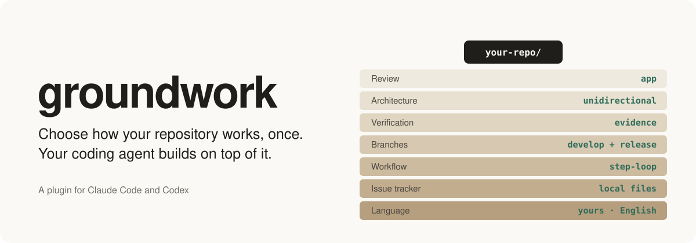
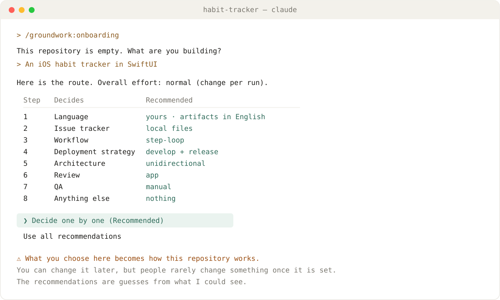
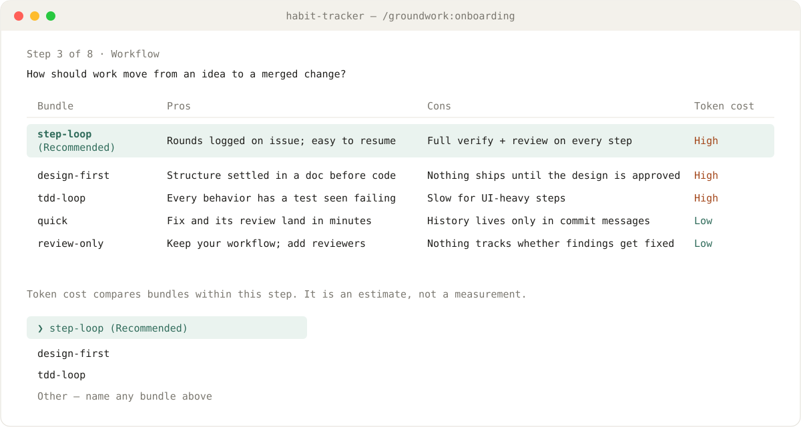
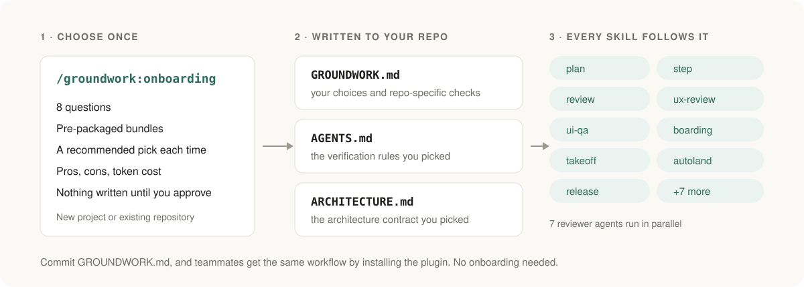

<p align="center">
  
</p>

<p align="center">
  <a href="LICENSE"></a>
  
  
  
</p>

<p align="center"><b>English</b> · <a href="README.ko.md">한국어</a></p>

**groundwork** is a Claude Code and Codex plugin that sets up how AI coding agents work in your repository — issue tracking, workflow, branch and release strategy, architecture, AI code review, and UI QA — and keeps your workflow running that way.

Running `/groundwork:onboarding` walks you through eight choices. Each choice is a **bundle**: a set of rules and skills designed to work together, complete with pros, cons, token cost, and a recommendation tailored to your repo. Your choices are saved to `GROUNDWORK.md`. Core implementation and testing rules go into `AGENTS.md` alongside your chosen rules, and architecture rules go into `ARCHITECTURE.md`. Every other groundwork skill reads these files, so the plugin adapts to whatever repo it's in.

It works best on a fresh `git init`:

- a side project you just started
- an assignment due at 9 a.m. tomorrow
- a hackathon project where you just want a quick prototype
- a quick throwaway repo only you will ever see

Set it up before your first commit so you start with rules, code reviews, and QA in place instead of `final_v2_REAL.py`. It works on existing repos too — it asks the same questions and recommends options based on your existing code and setup.

Before asking the first question, onboarding shows all eight steps and its recommended setup at a glance:

<p align="center">
  
</p>

At each step, you can compare the pros, cons, and token usage of each option:

<p align="center">
  
</p>

## How it works

<p align="center">
  
</p>

Claude Code and Codex share the exact same set of skills; only the plugin manifests differ.

## Install

Claude Code:

```
/plugin marketplace add enebin/groundwork
/plugin install groundwork@groundwork
```

Then run onboarding in the repo you want to set up:

```
/groundwork:onboarding
```

In Claude Code, groundwork checks GitHub for updates at most once a day and notifies you once per new release. To update, run `claude plugin update groundwork@groundwork` and restart Claude Code.

Optional: install [skeptic-review](https://github.com/enebin/skeptic-review) to double-check review findings before they reach you. If it isn't installed, reviews show `SkepticReview: OFF`.

## What onboarding sets up

| Step | Category | Options | New project default |
|---|---|---|---|
| 1 | Language | conversation / artifacts | your language / English (saves tokens) |
| 2 | Issue tracker | local files, GitHub Projects, Linear, Jira | local files |
| 3 | Workflow | step-loop, design-first, tdd-loop, quick, review-only; worktree per issue | step-loop, worktree per issue |
| 4 | Release strategy | develop + release, main only; merge style | develop + release |
| 5 | Architecture | unidirectional, mvvm, layered-service, layered-web, none | recommended based on stack |
| 6 | Review | app, sdk, service, product, light | recommended based on project type |
| 7 | Screen checks | UX: every PR, before release, manual; from the code or on the app. QA: every PR, before release, manual | UX: every PR, from the code. QA: manual |
| 8 | Custom rules | free text | none |

Before the first question, you'll see a table of recommendations tailored to your repo, and you can accept all of them at once if you want. That said, since these choices stick around, it's worth going through them one by one.

Testing isn't an optional toggle — it's built into implementation. Onboarding detects your repo's build/test commands and applicable checks, previews them for you, and writes the [default implementation rules](plugins/groundwork/reference/implementation.md) into `AGENTS.md`.

`eco / normal / sport` is a separate preset that controls overall thoroughness, defaulting to `normal`. Much like a model's reasoning-effort setting, it adjusts verification depth, review iterations, and screen-check scope together (without changing the model itself). For screen checks, `eco` and `normal` check only the screens a change may affect, and `sport` checks every screen. You can override it per run with `--mode` or tweak individual settings later. When screen checks run is still governed by the frequencies you chose in step 7.

You can browse the pros, cons, and exact rules written by each bundle in [`plugins/groundwork/catalog/`](plugins/groundwork/catalog/).

## Skills

| Skill | Description |
|---|---|
| `onboarding` | Initialize or update `GROUNDWORK.md` |
| `plan` | Break a large task into a parent issue and smaller step issues |
| `step` | Run a single step: implement, then loop through verify → review → fix until no confirmed 🔴/🟠 issues remain |
| `takeoff` | Rebase, push, and open the PR for a finished step |
| `landing`, `rejoin` | Clean up after a merge, or move a branch out of its worktree |
| `release`, `autoland` | Cut a release and auto-merge once CI passes |
| `review-and-fix`, `commit-push` | Fast, lightweight quick workflow |
| `review` | Run selected reviewers in parallel and combine their findings |
| `ux-review` | Usability review from the perspective of chosen user personas, from the code or on the app (runs per screen checks or on demand) |
| `ui-qa` | Launch the app to check UI behaviors automated tests can't cover (runs per screen checks or on demand) |

Five code reviewers can run on every change: `architecture-reviewer`, `code-quality-reviewer`, `security-reviewer`, `writing-reviewer`, and `dx-reviewer`. `dx-reviewer` traces developer tasks directly through the code, looking for friction from the perspective of developers using your library, HTTP/RPC API, or CLI. `ux-flow-reviewer` does the same for end-user journeys (extra steps, missing state handling, dead ends); it joins every review round when you pick code-based UX on every PR in step 7. Alongside their built-in checklists, each reviewer also checks repo-specific criteria under `## Review focus: <reviewer>` in `GROUNDWORK.md`.

UI changes are verified on every run by UI tests that capture screenshots, which the implementing agent opens and inspects directly. [Screen checks](plugins/groundwork/catalog/screen-checks.md) go further, in two parts. UX checks whether each user persona can finish its tasks, either from the code (fast, may be less accurate) or on the simulator or browser (slow, closest to real use). QA launches the app and checks the rendered UI against requirements and the design source. Each runs on every PR (`continuous`), before releases (`release`), or only when requested (`manual`). Checks on the running app can take a long time and use many tokens. Anything automated tests can't reliably verify is tracked in `docs/ui-coverage.md`.

Web projects are usually fast to check since browser tools can inspect DOM elements directly. iOS simulators and Android emulators can take longer due to build, install, and launch times as well as UI automation limits; web QA can also be slower if it relies heavily on screenshots. Actual time and token usage depend on coverage scope, number of personas, tooling, and retries.

Confirmed review issues are handed off to the `fixer` agent. Because it starts in a fresh context, fixes the issues, and re-runs the relevant tests on its own, your main working context only receives a short summary of what was fixed.

## GROUNDWORK.md

The full config specification lives in [`plugins/groundwork/reference/config.md`](plugins/groundwork/reference/config.md). Config keys are only ever added — existing keys are never renamed or removed. If the structure ever needs to change, the schema version is bumped and onboarding migrates your existing file automatically.

Commit `GROUNDWORK.md` and the docs generated by onboarding to your repo. Teammates just need to install the plugin to work under the exact same rules — no need for everyone to run onboarding again.

## License

MIT
